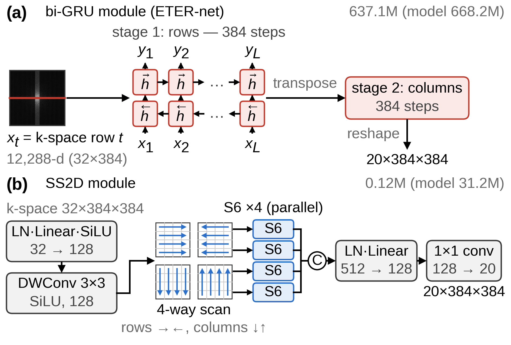
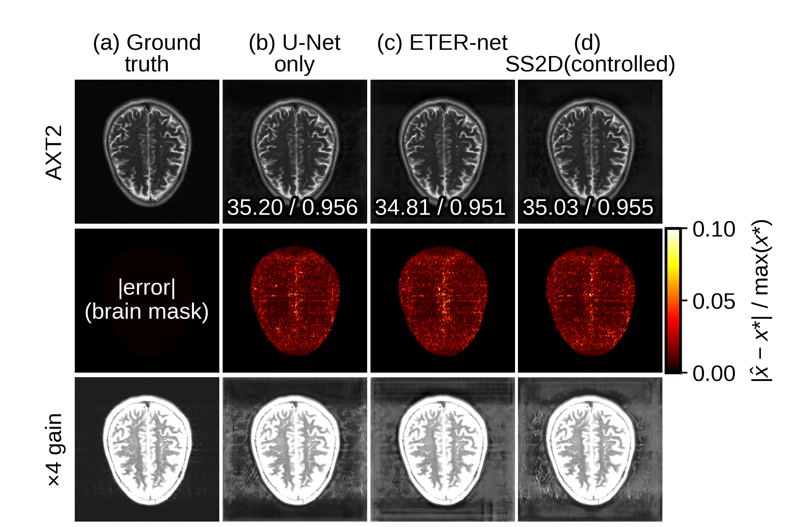

# 가속 MRI 재구성 네트워크 ETER-Net에서 순환신경망을 선택적 상태공간모델로 치환한 통제 비교 연구

**A Controlled Study of Replacing the RNN with a Selective SSM in ETER-Net for Accelerated MRI Reconstruction**

*(대한전자공학회 투고용 논문 양식 2021 — 저자·소속은 투고 시스템/게재용 양식에서 기입)*

## 요 약

ETER-net은 언더샘플링된 k-space를 양방향 순환신경망을 활용하여 영상 도메인으로 직접 변환하는 MRI 재구성 방법이다. 본 연구는 ETER-net의 도메인 변환 모듈(이하 시퀀스 모듈)인 양방향 GRU(gated recurrent unit, bi-GRU) 모듈을 2차원 선택적 상태공간모델(SS2D)로 교체한 모델(이하 SS2D(controlled))과 ETER-net의 재구성 성능을 비교한다. 본 연구의 구성에서는 U-Net이 다중 코일 zero-filled 영상도 함께 입력받는다. 또한 본 연구는 시퀀스 모듈의 출력을 0으로 대체한 U-Net only 모델을 대조 모델로 함께 학습하였다. fastMRI brain multicoil 데이터셋(384×384)의 k-space를 가속화 계수 4(R=4)로 언더샘플링한 조건에서, 모든 모델은 시퀀스 모듈과, ETER-net에만 적용한 GRU 한 개의 32비트 계산 및 기울기 보호 장치를 제외하면 데이터, 언더샘플링 마스크, U-Net 구조와 초깃값, 손실 함수, 최적화 설정이 같으며, 명시적 데이터 일관성 블록을 포함하지 않는다. SS2D(controlled)와 U-Net only 모델의 파라미터 수는 ETER-net의 약 1/21이다. 각 모델을 같은 난수 시드로 50 epochs 동안 한 번씩 학습하여 test_full 분할(558개 볼륨)에서 평가한 결과, brain mask 내부에서 계산한 볼륨 평균 structural similarity index(SSIM) 값은 기준 모델인 ETER-net보다 U-Net only가 0.0022, SS2D(controlled)가 0.0008 높았다(볼륨 단위 대응 Wilcoxon signed-rank 검정, $p<0.001$). SS2D(controlled)의 SSIM은 U-Net only보다 0.0014 낮았으므로, 본 연구는 SS2D(controlled)와 ETER-net의 차이를 상태공간 모델링의 효과로 해석하지 않는다. 학습 손실에 포함되지 않은 배경까지 평가하는 fastMRI 공식 평가 정의에서는 SS2D(controlled)의 SSIM이 ETER-net보다 낮았다(0.8389 대 0.8652). 각 모델을 한 번씩만 학습하였으므로, 이 차이들로 시퀀스 모듈이 재구성에 도움이 되는지 또는 해가 되는지는 판단할 수 없다.

## Abstract

ETER-net is an MRI reconstruction method that transforms undersampled k-space directly into the image domain with a bidirectional recurrent neural network. This study replaces its bidirectional gated recurrent unit (GRU) sequence module with a two-dimensional selective state-space model (SS2D), giving SS2D(controlled), and trains a U-Net only model whose sequence-module output is zeroed. All U-Nets also receive the zero-filled coil images, no model has a data-consistency block, and the models differ only in the sequence module (and, in ETER-net, 32-bit computation of one GRU and non-finite-gradient guards); SS2D(controlled) and the U-Net only model have about 1/21 of ETER-net's parameters. Each model was trained once (50 epochs, same seed) on the fastMRI brain multicoil dataset (384×384, R=4) and evaluated on the test_full split (558 volumes). Relative to the reference ETER-net, the volume-averaged structural similarity index (SSIM) within a brain mask was 0.0022 higher for the U-Net only model and 0.0008 higher for SS2D(controlled) (Wilcoxon signed-rank test, $p<0.001$). Because SS2D(controlled) scored 0.0014 below the U-Net only model, the SS2D(controlled)–ETER-net difference is not attributed to state-space modeling. Under the official fastMRI SSIM definition, which includes the background excluded from the loss, SS2D(controlled) scored below ETER-net (0.8389 vs. 0.8652). As each model was trained once, these differences do not show whether the sequence modules help or hurt reconstruction.

**Keywords :** MRI reconstruction, accelerated MRI, ETER-net, recurrent neural network, selective state-space model, SS2D, controlled comparison

---

## Ⅰ. 서론

자기공명영상(MRI)은 k-space를 순차적으로 수집하므로 촬영 시간이 길다. 촬영 시간을 단축하기 위해 언더샘플링된 k-space로부터 영상을 복원하는 딥러닝 기법이 연구되어 왔다. 대표적인 접근으로는 물리 모델 기반 반복 최적화 과정을 신경망 층으로 펼치는 방식(unrolling)[1]과 k-space를 영상으로 직접 변환하는 도메인 변환 방식[2]이 있다. ETER-net[3]은 후자에 속한다. 양방향 GRU(gated recurrent unit, bi-GRU)가 k-space를 행·열 방향으로 읽어 영상 도메인 특징으로 변환하고 U-Net이 에일리어싱(aliasing) 아티팩트를 줄이며, ETER-net은 명시적 데이터 일관성 블록을 사용하지 않는다[3, 4]. 이후 non-Cartesian 궤적[4]과 Vision Transformer 인코더 결합[5]으로 확장되었으나 도메인 변환의 핵심인 양방향 순환신경망(bi-RNN)은 유지되었다. 그러나 ETER-net은 행·열 방향을 순차 처리하는 구조여서 병렬화가 어렵고, flattened 2D 고차원 입력을 GRU로 처리하므로 대규모 가중치 행렬이 필요하며, 전체 파라미터 수가 수억 개에 이른다. 선택적 상태공간모델(SSM)인 Mamba[6]는 입력 의존 순환을 병렬 스캔으로 선형 시간에 계산하고, 이를 2차원으로 확장한 SS2D[7]는 선택적 스캔을 여러 방향으로 적용하여 2차원 공간 정보를 처리한다. 기존의 Mamba 기반 MRI 재구성 연구[8, 9]는 새로운 구조 전체를 제안하였고, 기존 골격에서 순환신경망만 SSM으로 바꾼 효과를 분리하여 보고하지 않았다. 본 논문은 ETER-net에서 도메인 변환을 담당하는 시퀀스 모듈만 bi-GRU에서 SS2D로 치환하고, 나머지 구조는 모두 고정한 상태에서 통제 비교 분석을 수행한다. 또한 시퀀스 모듈의 기여를 가늠하기 위해 그 출력을 0으로 대체한 U-Net only 모델을 함께 학습하여 비교한다.

## Ⅱ. 방법

### 1. 비교 실험의 공통 재구성 파이프라인

그림 1의 파이프라인에서는 완전 샘플링된(fully-sampled) k-space $y_c$에 가속화 계수가 4인(R=4) 등간격(equispaced) 마스크 $M$을 적용하여, 언더샘플링된 k-space $\tilde{y}_c$($=M \odot y_c$, $\odot$는 원소별 곱)를 생성한다. 이를 실수·허수로 분리한 32채널 텐서를 모델의 입력으로 사용한다. 마스크 $M$은 k-space 중앙 8%의 auto-calibration signal(ACS) 라인을 모두 포함한다. 한편, 참조 영상(Ground Truth) $x^{*}$는 데이터셋이 제공하는 전체 코일 RSS(Root-Sum-of-Squares) 영상을 384×384 크기로 크롭 및 패딩하여 생성한다. 순차적 입력을 처리하는 모듈 $f_\theta$(이하 시퀀스 모듈)는 입력 k-space를 영상 도메인 특징(20채널)으로 변환하도록 구성된다. 동일한 $\tilde{y}_c$에 코일별 역 푸리에 변환을 적용한 zero-filled 영상(32채널)과 시퀀스 모듈의 출력을 채널 축으로 결합한다. 후처리를 담당하는 U-Net $g_\phi$가 결합 텐서를 입력으로 하여 최종 결과인 크기(magnitude) 영상 $\hat{x}$을 출력한다(식 (1)). 실험에 사용한 U-Net은 dual-frame skip을 포함하며, 깊이가 5, 첫 단계의 채널 수가 64이고, 파라미터의 수는 31.1M이다.

$$ \hat{x} = g_{\phi}\left( \mathrm{concat}\left( f_{\theta}(\{\tilde{y}_c\}), \mathcal{F}^{-1}\{\tilde{y}_c\} \right) \right) \qquad (1) $$

식 (1)에서 $\{\tilde{y}_c\}$는 모든 코일($c$는 코일 인덱스)의 언더샘플링된 k-space, $\mathcal{F}^{-1}$는 코일별 2차원 역 푸리에 변환, $\mathrm{concat}$은 두 텐서를 채널 축으로 결합하는 연산이며, $\theta$와 $\phi$는 각각 $f_\theta$와 $g_\phi$의 학습 파라미터이다. 이하 비교하는 세 모델의 구조는 시퀀스 모듈의 구성(bi-GRU, SS2D, 없음)에서만 다르며, U-Net only 모델은 시퀀스 모듈의 출력 20채널을 0으로 대체한 모델(전체 파라미터 수 31.1M)이다. bi-RNN의 출력만 U-Net에 입력하는 [4]의 구조와 달리, 본 연구의 ETER-net은 공개된 구현 코드와 같이 U-Net이 시퀀스 모듈의 출력과 함께 32채널 zero-filled 영상을 입력받는다. zero-filled 영상은 언더샘플링된 k-space와 같은 정보를 담고 있으므로, U-Net only 모델도 다른 모델과 같은 입력 정보를 받는다.

Fig. 1. Common ETER-net pipeline; only the sequence module $f_\theta$ (dashed box) differs (output zeroed in the U-Net only model)

### 2. 시퀀스 모듈의 두 구성

ETER-net의 bi-GRU 모듈은 그림 2(a)에 나타나듯이, 입력 k-space를 384개 행의 시퀀스(스텝당 12,288차원)로 펼쳐 양방향 GRU를 통과시킨 뒤, 전치하여 열 방향으로 한 번 더 통과시키는 구조이다. 다만 공개 구현과 같이 32×384×384 입력을 순서를 바꾸지 않고 384×12,288로 재배열하므로, 한 스텝은 한 채널의 연속된 32개 행에 해당한다. bi-GRU 모듈의 파라미터의 수는 637.1M, 모델의 전체 파라미터의 수는 668.2M이다. 그림 2(b)는 SS2D 모듈을 나타낸다. 이 모듈은 각 k-space 위치의 32채널 벡터를 층 정규화(Layer Normalization, LN)와 선형 층을 거쳐 128채널로 바꾸고 3×3 depthwise convolution으로 이웃 위치의 정보를 혼합한 뒤, 각 행에 대해서는 좌우 두 방향, 각 열에 대해서는 상하 두 방향으로 S6를 적용하여 선택적 스캔을 수행한다. SS2D 모듈은 원 SS2D[7]와 같이 방향마다 독립된 가중치를 적용하지만, 특징 지도 전체를 네 가지 순회 경로마다 한 시퀀스로 펼치는 원 SS2D와 달리 384 길이의 각 행과 열을 독립 시퀀스로 처리한다. 마지막으로 네 방향의 출력을 채널 축으로 결합한 뒤 bi-GRU 모듈의 출력과 같은 20채널로 변환한다. S6는 Mamba[6]에서 정의한 구조(S4 + selection + scan)로, 구조화 상태 공간 시퀀스 모델(S4)에 입력에 따라 계수가 달라지는 선택(selection) 메커니즘을 더한 것이며 스캔(scan) 알고리즘으로 계산된다. S6는 한 행 또는 한 열의 시퀀스를 식 (2)의 이산화된 상태 공간 시스템으로 처리한다.

$$ h_t = \exp(\Delta_t A)\, h_{t-1} + \Delta_t B_t x_t, \quad y_t = C_t h_t + D x_t \qquad (2) $$

식 (2)에서 아래첨자 $t$는 스캔 방향을 따라 부여한 시퀀스 내 위치($t = 1, \ldots, L$, 시퀀스 길이 $L=384$)를 의미한다. $x_t$와 $y_t$는 위치 $t$의 입력과 출력이고, $h_t$와 $h_{t-1}$은 각각 위치 $t$와 $t-1$까지의 입력을 요약한 $N$차원($N=16$) 은닉 상태 벡터이다. $A$는 학습 가능한 $N \times N$ 대각 상태 행렬이고, $\exp(\Delta_t A)$는 $A$를 간격 $\Delta_t$로 이산화한 상태 전이 행렬이다. $B_t$와 $C_t$는 각각 $N \times 1$ 입력 행렬과 $1 \times N$ 출력 행렬로, 입력을 은닉 상태에 반영하는 계수와 은닉 상태로부터 출력을 계산하는 계수이다. $D$는 입력 $x_t$에 곱해져 출력에 직접 더해지는 skip 계수이다. 식 (2)는 128개 내부 채널 각각에 독립적으로 적용되므로, $x_t$와 $y_t$는 한 채널의 스칼라 값이고 $A$와 $D$는 채널마다 따로 학습된다. softplus 함수를 거친 채널별 양수 $\Delta_t$와 모든 채널에 공통인 $B_t$, $C_t$는 위치 $t$의 128채널 입력 벡터를 선형 층에 통과시켜 얻은 값이다.

bi-GRU 모듈도 모든 스텝에 같은 가중치를 사용하지만, 한 스텝의 입력이 12,288(=32×384)차원 벡터이고 은닉 상태가 3,840(=10×384)차원이어서 가중치 행렬의 크기가 영상 한 변의 크기(384)의 제곱에 비례한다. 반면 SS2D 모듈은 한 k-space 위치를 한 스텝으로 처리하여 한 스텝의 입력이 128채널 벡터이고 은닉 상태가 채널마다 $N$(=16)차원이므로, 가중치 행렬의 크기가 영상 크기와 무관하고 파라미터 수가 0.12M이다. 또한 SS2D 모듈의 각 출력은 같은 행과 열 주변(폭 3의 십자 영역)의 입력에만 의존하므로, 이 모듈만으로는 2차원 역 푸리에 변환을 표현할 수 없다. SS2D(controlled)는 SS2D 모듈 하나만을 시퀀스 모듈로 구성한 모델(전체 파라미터 수 31.2M)이다. 본 연구에서는 모델별 하이퍼파라미터 조정을 수행하지 않았다.

Fig. 2. Sequence modules $f_\theta$: (a) bi-GRU module of ETER-net, (b) SS2D module

### 3. 학습·평가 프로토콜

학습에는 fastMRI brain multicoil 데이터셋[10]의 공식 학습 분할에서 확보한 4,110개 볼륨을 사용하였다. 공식 검증 분할 전체(1,378개 볼륨)는 학습 중 검증과 최적 체크포인트 선택에 사용하였다. 최종 평가는 참조 영상이 공개된 공식 시험 분할(test_full, 558개 볼륨, 슬라이스 8,852개)에서 수행하였으며, 세 분할 사이에 겹치는 볼륨은 없다. 데이터셋에는 축상면(axial) T1, 조영제 투여 전후 T1, T2, 액체감쇠역전회복(FLAIR) 영상이 혼합되어 있다(평가 볼륨의 약 58%가 축상면 T2 영상(AXT2)). $y_c$는 완전 샘플링된 k-space를 코일별 영상으로 변환하여 384×384 크기로 크롭 및 패딩한 뒤 다시 k-space로 변환한 것이다. 코일은 처음 16개만 사용하고 부족한 채널은 0으로 채워 16개로 통일하였다. 모델에는 식 (1)의 $\tilde{y}_c$ 대신 식 (3)의 슬라이스별 정규화 계수 $s$로 나눈 $\tilde{y}_c/s$를 입력하고, 출력에 $s$를 곱한 값을 복원 영상 $\hat{x}$으로 하여 원래 세기에서 평가하였다. 등간격 샘플링 라인의 시작 위치(mask offset)는 학습 시에만 샘플마다 무작위로 정하였다. 학습 시에는 영상을 상하·좌우로 무작위 반전하여 데이터를 증강하였다. 배경 영역의 영향을 줄이기 위해 슬라이스마다 참조 영상 $x^{*}$의 0이 아닌 화소에서 Otsu 임곗값 $T$[11]를 구하고, $x^{*} > 0.4T$인 화소들의 연결 성분 중 가장 큰 것을 brain mask $m$으로 정의하였다. $T$는 화소를 두 집단으로 나누었을 때 집단 간 분산을 최대로 하는 임곗값이다. 학습 시 역전파에 사용한 손실 함수(식 (4))와 세 평가 지표인 structural similarity index(SSIM), peak signal-to-noise ratio(PSNR), normalized mean squared error(nMSE)는 모두 이 마스크 내부에서만 계산하였다. 평가 SSIM은 scikit-image로 구한 SSIM 지도의 마스크 내부 평균이고, 동적 범위(data range)는 마스크 내부 $x^{*}$의 최댓값과 최솟값의 차이이며, PSNR의 최대 신호 값(peak)과 nMSE의 분모도 마스크 내부의 $x^{*}$로 구하였다.

$$ s = \mathrm{P}_{99}\left( \sqrt{\sum_{c} \left| \mathcal{F}^{-1}\{\tilde{y}_c\} \right|^{2}} \right) \qquad (3) $$

$$ \mathcal{L} = \frac{\sum_{i} m_i \left| \hat{x}_i/s - x^{*}_i/s \right|}{\sum_{i} m_i} + \lambda \left( 1 - \mathrm{SSIM}_m(\hat{x}/s, x^{*}/s) \right) \qquad (4) $$

식 (3)의 $s$는 zero-filled RSS 영상의 384×384 화소 값에 대한 99 백분위수($\mathrm{P}_{99}$)이다. 식 (4)에서 $\mathcal{L}$은 손실 함수, $i$는 화소 인덱스, $\sum_{i}$는 모든 화소에 대한 합이다. $m_i$는 화소 $i$가 brain mask $m$ 내부이면 1, 외부이면 0이고, $x^{*}_i$와 $\hat{x}_i$는 각각 화소 $i$에서의 참조 영상 $x^{*}$와 복원 영상 $\hat{x}$의 값이다. $\mathrm{SSIM}_m(\hat{x}/s, x^{*}/s)$는 $\hat{x}/s$와 $x^{*}/s$의 SSIM 지도를 마스크 $m$ 내부에서 평균한 값이다. SSIM 항의 가중치 $\lambda$는 원래 세기에서의 가중치 $10^{-6}$을 학습 슬라이스 64개의 $s$ 평균 $\bar{s}$로 나눈 값(약 $3.1\times10^{-3}$)이며, 학습 종료 시 첫째 항은 둘째 항의 약 66배였다. 최적화에는 분리형(decoupled) weight decay를 적용한 AdamW를 사용하였으나, 설정값 $3\times10^{-5}$의 감쇠는 단정밀도 가중치를 바꾸지 못할 만큼 작아 실효적으로 적용되지 않았다. 학습률은 코사인 어닐링 방식으로 $2\times10^{-4}$에서 $1\times10^{-6}$까지 감소하였고, 배치 크기는 8이다. 계산은 16비트 부동소수점(fp16) 자동 혼합 정밀도로 수행하고 기울기가 유한하지 않은 step은 건너뛰었으나, ETER-net의 가로 방향(1단계) GRU는 32비트 부동소수점(fp32)으로 계산하였고, ETER-net에는 그러한 step에 대한 보호 장치(재계산과 손실 배율 하한)를 더하였다. 세 모델은 모두 난수 시드를 1로 고정하여 같은 순서의 학습 데이터와 같은 U-Net 초깃값으로 50 epochs 동안 한 번씩 처음부터 학습하였고, 2 epoch마다 검증하여 검증 집합의 SSIM이 가장 높은 체크포인트를 최종 평가에 사용하였다. 이 공통 학습 설정은 원 ETER-net 구현과 학습 데이터(혼합 대조도 4,110개 볼륨 대 AXT2 300개 볼륨), 세기 정규화(슬라이스별 정규화 대 고정 배율), 마스크(무작위 시작 위치와 ACS 31줄 대 고정 시작 위치와 32줄), 증강, 손실 함수, 최적화 방법, 계산 정밀도, GRU 은닉 크기 배수 $H$(본 연구 10, 공개 구현 12)에서 다르다. 각 지표는 슬라이스별로 계산하여 볼륨마다 평균한 뒤, 평가 볼륨 558개에 대한 평균과 표준편차로 나타내었다. 또한 같은 볼륨에 대한 두 모델의 지표를 짝지어 대응(paired) 비교하고, 상대 모델보다 우수한 볼륨의 비율(우위 비율)을 지표별로 구하였다. 유의성은 볼륨 단위 양측 Wilcoxon signed-rank 검정으로 평가하였다.

## Ⅲ. 실험 결과

### 1. 정량 평가

표 1은 각 모델의 최적 체크포인트를 test_full 분할에 적용한 결과이다. U-Net only와 SS2D(controlled)의 SSIM과 PSNR은 기준 모델인 ETER-net보다 각각 0.0022와 0.23 dB, 0.0008과 0.10 dB 높았고(SSIM 우위 비율 99.6%, 81.2%), nMSE는 두 모델 모두 ETER-net보다 낮았다(모든 비교에서 $p<0.001$). 그러나 마스크 없이 참조 볼륨의 최댓값을 동적 범위로 쓰는 fastMRI 공식 평가 정의[10]의 SSIM은 U-Net only 0.8965, ETER-net 0.8652, SS2D(controlled) 0.8389로, SS2D(controlled)가 ETER-net보다 0.0262 낮았다(우위 비율 14.3%, $p<0.001$). 같은 정의의 SSIM 지도를 평균하면 brain mask 내부에서는 SS2D(controlled)가 0.0005 높았고, 학습 손실에 포함되지 않은 마스크 외부에서는 0.0398 낮았다.

SS2D(controlled)의 표 1 SSIM은 시퀀스 모듈이 없는 U-Net only보다 0.0014 낮았고(SS2D(controlled)가 우수한 볼륨 558개 중 12개, $p<0.001$), SS2D 모듈 출력의 제곱평균제곱근은 0.0057이었으며, 시험 슬라이스 512개에서 이 출력을 다른 볼륨의 출력으로 바꾸었을 때 SSIM 하락은 평균 0.00047이었다. 따라서 본 연구는 SS2D(controlled)와 ETER-net의 차이를 상태공간 모델링의 효과로 해석하지 않는다. 또한 마지막 epoch의 학습 손실은 ETER-net과 SS2D(controlled)가 U-Net only보다 각각 2.0%, 1.6% 높아, 시퀀스 모듈을 포함한 모델의 결과에는 최적화 차이(ETER-net은 계산 정밀도와 보호 장치의 차이 포함)가 반영되었을 수 있다. 각 모델을 한 번씩만 학습하였으므로 위 검정은 평가 볼륨 간 변동만 반영하고 학습 회차 간 변동은 반영하지 않는다.

Table 1. Volume-level results (mean ± standard deviation) on the fastMRI brain test_full split (558 volumes, R=4, brain-masked)

| Model | SSIM | PSNR (dB) | nMSE (%) |
|---|---|---|---|
| U-Net only | 0.9213±0.0466 | 34.91±1.85 | 0.371±0.409 |
| ETER-net | 0.9191±0.0474 | 34.69±1.84 | 0.388±0.434 |
| SS2D (controlled) | 0.9199±0.0469 | 34.78±1.86 | 0.381±0.414 |

Note. 본문의 차이는 짝지은 차이의 평균(반올림 전)이므로, 반올림한 평균끼리 뺀 값과 마지막 자리가 다를 수 있다.

### 2. 정성 비교

그림 3은 사전에 지정한 검증 AXT2 슬라이스 1개에 대한 세 모델의 출력이다. 표시 강도를 4배로 증폭한 하단 행에서 ETER-net과 SS2D(controlled)의 머리 밖 배경에는 U-Net only보다 뚜렷한 구조적 패턴이 나타났으며, 평가 볼륨 전체의 brain mask 외부 공식 정의 SSIM 지도 평균도 U-Net only 0.8592, ETER-net 0.8123, SS2D(controlled) 0.7725였다.

Fig. 3. AXT2 validation slice without intensity rescaling: reconstructions with brain-masked PSNR (dB)/SSIM (top), brain-masked error maps (middle), and ×4 gain images (bottom)

## Ⅳ. 결론

본 연구에서 기준 모델인 ETER-net과, 그 시퀀스 모듈만 교체하거나 제거한 두 모델을 fastMRI brain 데이터셋의 R=4 조건에서 한 번씩 학습하여 test_full 분할에서 평가한 결과, brain mask 내부의 볼륨 평균 SSIM은 ETER-net보다 U-Net only가 0.0022, SS2D(controlled)가 0.0008 높았다. 다만 SS2D(controlled)는 U-Net only보다 SSIM이 0.0014 낮았으므로, 본 연구는 SS2D(controlled)와 ETER-net의 차이를 상태공간 모델링의 효과로 해석하지 않으며 SSM과 순환신경망 전반의 우열로 일반화할 수도 없다. 두 모듈은 순환 방식과 파라미터 구성이 다르고 SS2D 모듈은 2차원 역 푸리에 변환을 표현할 수 없어, 본 연구에서는 각 요인의 기여를 분리하지 못하였다. 또한 각 모델을 한 번씩만 학습하였고 시퀀스 모듈을 포함한 모델의 학습 손실이 더 높았으므로, 시퀀스 모듈이 재구성에 미치는 효과의 방향은 판단할 수 없다. 공식 평가 정의에서 마스크 외부의 차이로 SS2D(controlled)와 ETER-net의 순위가 바뀐 점, 학습 설정이 원 구현과 다른 점, AXT2 비중이 높은 단일 데이터셋과 단일 가속화 계수에서 평가한 점도 본 연구의 한계이다. 향후 연구에서는 여러 난수 시드와 원 구현의 학습 설정, 더 높은 가속화 계수에서 시퀀스 모듈의 기여를 평가할 계획이다.

## REFERENCES

[1] A. Sriram et al., "End-to-End Variational Networks for Accelerated MRI Reconstruction," in *Proc. MICCAI*, LNCS, vol. 12262, pp. 64–73, 2020.  
[2] B. Zhu et al., "Image reconstruction by domain-transform manifold learning," *Nature*, vol. 555, pp. 487–492, 2018.  
[3] C. Oh et al., "A k-space-to-image reconstruction network for MRI using recurrent neural network," *Med. Phys.*, vol. 48, no. 1, pp. 193–203, 2021.  
[4] C. Oh et al., "An End-to-End Recurrent Neural Network for Radial MR Image Reconstruction," *Sensors*, vol. 22, no. 19, Art. no. 7277, 2022.  
[5] C. Oh, "A Hybrid Vision Transformer-BiRNN Architecture for Direct k-Space to Image Reconstruction in Accelerated MRI," *J. Imaging*, vol. 12, no. 1, Art. no. 11, 2026.  
[6] A. Gu and T. Dao, "Mamba: Linear-Time Sequence Modeling with Selective State Spaces," arXiv preprint arXiv:2312.00752, 2023.  
[7] Y. Liu et al., "VMamba: Visual State Space Model," in *Proc. NeurIPS*, 2024.  
[8] Y. Korkmaz and V. M. Patel, "MambaRecon: MRI Reconstruction with Structured State Space Models," in *Proc. IEEE/CVF WACV*, pp. 4142–4152, 2025.  
[9] J. Huang et al., "Enhancing global sensitivity and uncertainty quantification in medical image reconstruction with Monte Carlo arbitrary-masked Mamba," *Med. Image Anal.*, vol. 99, Art. no. 103334, 2025.  
[10] J. Zbontar et al., "fastMRI: An Open Dataset and Benchmarks for Accelerated MRI," arXiv preprint arXiv:1811.08839, 2018.  
[11] N. Otsu, "A Threshold Selection Method from Gray-Level Histograms," *IEEE Trans. Syst., Man, Cybern.*, vol. 9, no. 1, pp. 62–66, 1979.  
