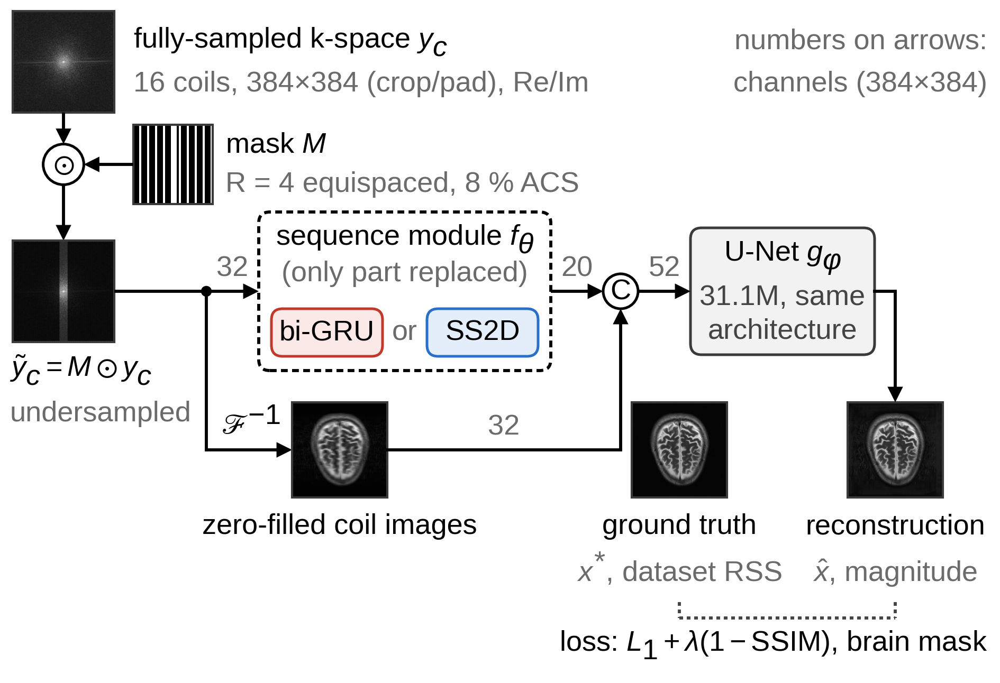

# 가속 MRI 재구성 네트워크 ETER-Net에서 순환신경망을 선택적 상태공간모델로 치환한 통제 비교 연구

**A Controlled Study of Replacing the RNN with a Selective SSM in ETER-Net for Accelerated MRI Reconstruction**

*(대한전자공학회 투고용 논문 양식 2021 — 저자·소속은 투고 시스템/게재용 양식에서 기입)*

## 요 약

ETER-net은 언더샘플링된 k-space를 양방향 순환신경망으로 영상 도메인에 직접 변환하는 MRI 재구성 방법이다. 본 연구는 ETER-net의 양방향 GRU(gated recurrent unit, bi-GRU) 시퀀스 모듈을 2차원 선택적 상태공간모델(SS2D)로 교체한 SS2D(controlled)와 시퀀스 모듈의 출력을 0으로 대체한 U-Net only 모델을 ETER-net과 비교한다. U-Net은 zero-filled 영상도 함께 입력받으며, 세 모델은 시퀀스 모듈과 ETER-net에만 적용한 계산 정밀도·기울기 보호 설정을 제외하면 구조와 학습 설정이 같다. fastMRI brain 데이터셋(R=4)에서 각 모델을 같은 난수 시드로 50 epochs 동안 한 번씩 학습하여 test_full 분할(558개 볼륨)에서 평가한 결과, brain mask 내부의 볼륨 평균 structural similarity index(SSIM)는 ETER-net보다 U-Net only가 0.0022, SS2D(controlled)가 0.0008 높았다($p<0.001$). 그러나 SS2D(controlled)는 U-Net only보다 0.0014 낮았으므로 이 차이를 상태공간 모델링의 효과로 해석하지 않으며, fastMRI 공식 평가 정의에서는 SS2D(controlled)가 ETER-net보다 낮았다(0.8389 대 0.8652). 각 모델을 한 번씩만 학습하였으므로 시퀀스 모듈이 재구성에 도움이 되는지는 판단할 수 없다.

## Abstract

ETER-net reconstructs MR images by mapping undersampled k-space to the image domain with a bidirectional recurrent neural network. We replace its bidirectional gated recurrent unit (GRU) sequence module with a two-dimensional selective state-space model (SS2D), giving SS2D(controlled), and also train a U-Net only model whose sequence-module output is zeroed. All U-Nets also receive the zero-filled coil images, and the models differ only in the sequence module (and, in ETER-net, 32-bit computation of one GRU and gradient guards). Each model was trained once (50 epochs, same seed) on fastMRI brain data (R=4) and evaluated on the test_full split (558 volumes). The brain-masked volume-averaged structural similarity index (SSIM) was 0.0022 higher for U-Net only and 0.0008 higher for SS2D(controlled) than for ETER-net ($p<0.001$). Because SS2D(controlled) scored 0.0014 below U-Net only, this difference is not attributed to state-space modeling, and under the official fastMRI SSIM definition SS2D(controlled) scored below ETER-net (0.8389 vs. 0.8652). As each model was trained once, these results do not show whether the sequence modules help or hurt reconstruction.

**Keywords :** MRI reconstruction, ETER-net, recurrent neural network, selective state-space model, SS2D

---

## Ⅰ. 서론

자기공명영상(MRI)의 딥러닝 재구성에는 반복 최적화를 신경망 층으로 펼치는 방식(unrolling)[1]과 k-space를 영상으로 직접 변환하는 도메인 변환 방식[2]이 있다. 후자인 ETER-net[3]은 양방향 GRU(gated recurrent unit, bi-GRU)로 k-space를 행·열 방향으로 읽어 영상 도메인 특징으로 바꾸고 U-Net으로 에일리어싱(aliasing)을 줄이며, 명시적 데이터 일관성 블록이 없다[3, 4]. 이 구조는 non-Cartesian 궤적[4]과 Vision Transformer 결합[5]으로 확장되었으나, 순차 처리로 병렬화가 어렵고 파라미터가 수억 개에 이른다. 선택적 상태공간모델(SSM)인 Mamba[6]와 그 2차원 확장인 SS2D[7]는 순환을 병렬 스캔으로 계산하지만, Mamba 기반 MRI 재구성 연구[8]는 새로운 구조 전체를 제안하여 순환신경망만 바꾼 효과를 분리하지 않았다. 본 논문은 ETER-net의 시퀀스 모듈만 SS2D로 치환한 모델과 시퀀스 모듈의 출력을 0으로 대체한 U-Net only 모델을 ETER-net과 통제 비교한다.

## Ⅱ. 방법

### 1. 공통 재구성 파이프라인

그림 1과 같이 완전 샘플링된(fully-sampled) k-space $y_c$에 가속화 계수가 4인(R=4) 등간격(equispaced) 마스크 $M$(중앙 8%의 auto-calibration signal(ACS) 라인 포함)을 적용한 $\tilde{y}_c$($=M \odot y_c$, $\odot$는 원소별 곱)를 실수·허수로 분리한 32채널 텐서로 입력한다. 참조 영상 $x^{*}$는 데이터셋이 제공하는 전체 코일 RSS(Root-Sum-of-Squares) 영상을 384×384로 크롭 및 패딩한 것이다. 시퀀스 모듈 $f_\theta$는 k-space를 영상 도메인 특징(20채널)으로 변환하고, U-Net $g_\phi$는 이 특징과 zero-filled 영상(32채널)을 결합한 텐서로부터 크기(magnitude) 영상 $\hat{x}$을 출력한다(식 (1)).

$$ \hat{x} = g_{\phi}\left( \mathrm{concat}\left( f_{\theta}(\{\tilde{y}_c\}), \mathcal{F}^{-1}\{\tilde{y}_c\} \right) \right) \qquad (1) $$

식 (1)에서 $\{\tilde{y}_c\}$는 모든 코일($c$는 코일 인덱스)의 언더샘플링된 k-space, $\mathcal{F}^{-1}$는 코일별 2차원 역 푸리에 변환, $\mathrm{concat}$은 채널 축 결합 연산이며, $\theta$와 $\phi$는 각각 $f_\theta$와 $g_\phi$의 학습 파라미터이다. U-Net은 dual-frame skip을 포함하며 깊이가 5, 첫 단계의 채널 수가 64, 파라미터 수가 31.1M이다. 세 모델은 시퀀스 모듈(bi-GRU, SS2D, 없음)에서만 다르며, U-Net only 모델은 그 출력을 0으로 대체한 모델이다. U-Net은 [4]와 달리 공개 구현과 같이 zero-filled 영상도 입력받으므로, U-Net only 모델도 같은 입력 정보를 받는다.

Fig. 1. Common pipeline; only the sequence module $f_\theta$ (dashed box) differs

### 2. 시퀀스 모듈의 두 구성

ETER-net의 bi-GRU 모듈은 공개 구현과 같이 32×384×384 입력을 384×12,288 시퀀스로 재배열하여(한 스텝은 한 채널의 연속된 32개 행) 양방향 GRU를 통과시킨 뒤, 전치하여 열 방향으로 한 번 더 통과시키며, 은닉 상태가 3,840(=10×384)차원이어서 파라미터 수가 637.1M(모델 전체 668.2M)이다. SS2D 모듈은 각 k-space 위치의 32채널 벡터를 층 정규화(Layer Normalization), 선형 층, 3×3 depthwise convolution으로 128채널 특징으로 바꾼 뒤, 행의 좌우와 열의 상하 네 방향으로 S6(입력에 따라 계수가 달라지는 Mamba[6]의 선택적 상태공간 스캔)를 적용하고 그 출력을 결합하여 20채널로 변환한다. 방향마다 독립된 가중치를 쓰는 점은 원 SS2D[7]와 같지만, 특징 지도 전체를 순회 경로마다 한 시퀀스로 펼치는 원 SS2D와 달리 각 행과 열을 독립 시퀀스로 처리한다. SS2D 모듈의 파라미터 수는 0.12M(모델 전체 31.2M)이며, 각 출력이 같은 행과 열 주변(폭 3의 십자 영역)의 입력에만 의존하므로 이 모듈만으로는 2차원 역 푸리에 변환을 표현할 수 없다.

### 3. 학습·평가 프로토콜

학습에는 fastMRI brain multicoil 데이터셋[9]의 공식 학습 분할에서 확보한 4,110개 볼륨을, 체크포인트 선택에는 공식 검증 분할 전체(1,378개 볼륨)를, 평가에는 공식 시험 분할(test_full, 558개 볼륨)을 사용하였으며, 분할 간에 겹치는 볼륨은 없다. 코일은 처음 16개만 사용하였고, 학습 시에는 마스크의 시작 위치와 상하·좌우 반전을 무작위로 정하였다. 모델에는 식 (1)의 $\tilde{y}_c$ 대신 식 (2)의 슬라이스별 정규화 계수 $s$로 나눈 $\tilde{y}_c/s$를 입력하고, 출력에 $s$를 곱한 값을 복원 영상 $\hat{x}$으로 하였다. brain mask $m$은 $x^{*}$의 0이 아닌 화소에서 구한 Otsu 임곗값 $T$[10](집단 간 분산을 최대로 하는 임곗값)에 대해 $x^{*} > 0.4T$인 화소의 가장 큰 연결 성분이다.

$$ s = \mathrm{P}_{99}\left( \sqrt{\sum_{c} \left| \mathcal{F}^{-1}\{\tilde{y}_c\} \right|^{2}} \right) \qquad (2) $$

$$ \mathcal{L} = \frac{\sum_{i} m_i \left| \hat{x}_i/s - x^{*}_i/s \right|}{\sum_{i} m_i} + \lambda \left( 1 - \mathrm{SSIM}_m(\hat{x}/s, x^{*}/s) \right) \qquad (3) $$

식 (2)의 $s$는 zero-filled RSS 영상의 384×384 화소 값에 대한 99 백분위수($\mathrm{P}_{99}$)이다. 식 (3)에서 $\mathcal{L}$은 손실 함수, $i$는 화소 인덱스, $m_i$는 화소 $i$가 마스크 내부이면 1, 외부이면 0인 값, $x^{*}_i$와 $\hat{x}_i$는 화소 $i$에서의 참조 영상과 복원 영상의 값이며, $\mathrm{SSIM}_m$은 structural similarity index(SSIM) 지도의 마스크 내부 평균이다. 가중치 $\lambda$는 원래 세기에서의 가중치 $10^{-6}$을 학습 슬라이스 64개의 $s$ 평균으로 나눈 값(약 $3.1\times10^{-3}$)이다. 최적화는 AdamW(배치 크기 8)로 하였고, 학습률은 코사인 어닐링 방식으로 $2\times10^{-4}$에서 $1\times10^{-6}$까지 감소하였다. 계산은 16비트 부동소수점(fp16) 자동 혼합 정밀도로 수행하였으나, ETER-net은 가로 방향 GRU를 32비트(fp32)로 계산하고 기울기가 유한하지 않은 step에 대한 보호 장치를 더하였다. 세 모델은 모델별 하이퍼파라미터 조정 없이 같은 설정과 난수 시드 1로 50 epochs 동안 한 번씩 학습하였고, 검증 SSIM이 가장 높은 체크포인트(2 epoch마다 검증)를 사용하였다. 이 설정은 데이터, 정규화, 마스크, 증강, 손실, 최적화, 정밀도, GRU 은닉 크기 배수(본 연구 10, 공개 구현 12)에서 원 ETER-net 구현과 다르다. 평가 지표인 SSIM, peak signal-to-noise ratio(PSNR), normalized mean squared error(nMSE)는 손실과 같이 마스크 내부에서 계산하였으며, SSIM의 동적 범위는 마스크 내부 $x^{*}$의 최댓값과 최솟값의 차이이다. 모델 간 비교에는 볼륨별로 짝지은 우위 비율과 양측 Wilcoxon signed-rank 검정을 사용하였다.

## Ⅲ. 실험 결과

표 1에서 U-Net only와 SS2D(controlled)의 SSIM과 PSNR은 기준 모델인 ETER-net보다 각각 0.0022와 0.23 dB, 0.0008과 0.10 dB 높았고, nMSE는 두 모델 모두 ETER-net보다 낮았다(모든 비교에서 $p<0.001$). 그러나 마스크 없이 참조 볼륨의 최댓값을 동적 범위로 쓰는 fastMRI 공식 평가 정의[9]의 SSIM은 U-Net only 0.8965, ETER-net 0.8652, SS2D(controlled) 0.8389로 SS2D(controlled)가 ETER-net보다 0.0262 낮았고(우위 비율 14.3%, $p<0.001$), 이 차이는 학습 손실에 포함되지 않은 마스크 외부에서 생겼다(SSIM 지도 평균: 내부 +0.0005, 외부 −0.0398).

그런데 SS2D(controlled)의 SSIM은 시퀀스 모듈이 없는 U-Net only보다 0.0014 낮았으므로(SS2D(controlled)가 우수한 볼륨 558개 중 12개, $p<0.001$), 본 연구는 SS2D(controlled)와 ETER-net의 차이를 상태공간 모델링의 효과로 해석하지 않는다. 마지막 epoch의 학습 손실은 ETER-net과 SS2D(controlled)가 U-Net only보다 각각 2.0%, 1.6% 높아 최적화 차이가 반영되었을 수 있으며, 각 모델을 한 번씩만 학습하였으므로 위 검정은 학습 회차 간 변동을 반영하지 않는다.

Table 1. Volume-level results (mean ± standard deviation) on the fastMRI brain test_full split (558 volumes, R=4, brain-masked)

| Model | SSIM | PSNR (dB) | nMSE (%) |
|---|---|---|---|
| U-Net only | 0.9213±0.0466 | 34.91±1.85 | 0.371±0.409 |
| ETER-net | 0.9191±0.0474 | 34.69±1.84 | 0.388±0.434 |
| SS2D (controlled) | 0.9199±0.0469 | 34.78±1.86 | 0.381±0.414 |

Note. 본문의 차이는 짝지은 차이의 평균(반올림 전)이므로, 반올림한 평균끼리 뺀 값과 마지막 자리가 다를 수 있다.

## Ⅳ. 결론

ETER-net의 시퀀스 모듈만 교체하거나 제거한 두 모델은 brain mask 내부 SSIM이 ETER-net보다 높았으나, SS2D(controlled)가 U-Net only보다 낮았으므로, 본 연구는 이 차이를 상태공간 모델링의 효과나 SSM과 순환신경망의 우열로 해석하지 않는다. 두 모듈의 구성 차이, 모델마다 한 번뿐인 학습, 공식 평가 정의에서의 순위 역전, 단일 데이터셋과 단일 가속화 계수는 본 연구의 한계이며, 향후 여러 난수 시드와 원 구현의 학습 설정에서 시퀀스 모듈의 기여를 평가할 계획이다.

## REFERENCES

[1] A. Sriram et al., "End-to-End Variational Networks for Accelerated MRI Reconstruction," in *Proc. MICCAI*, LNCS, vol. 12262, pp. 64–73, 2020.  
[2] B. Zhu et al., "Image reconstruction by domain-transform manifold learning," *Nature*, vol. 555, pp. 487–492, 2018.  
[3] C. Oh et al., "A k-space-to-image reconstruction network for MRI using recurrent neural network," *Med. Phys.*, vol. 48, no. 1, pp. 193–203, 2021.  
[4] C. Oh et al., "An End-to-End Recurrent Neural Network for Radial MR Image Reconstruction," *Sensors*, vol. 22, no. 19, Art. no. 7277, 2022.  
[5] C. Oh, "A Hybrid Vision Transformer-BiRNN Architecture for Direct k-Space to Image Reconstruction in Accelerated MRI," *J. Imaging*, vol. 12, no. 1, Art. no. 11, 2026.  
[6] A. Gu and T. Dao, "Mamba: Linear-Time Sequence Modeling with Selective State Spaces," arXiv preprint arXiv:2312.00752, 2023.  
[7] Y. Liu et al., "VMamba: Visual State Space Model," in *Proc. NeurIPS*, 2024.  
[8] Y. Korkmaz and V. M. Patel, "MambaRecon: MRI Reconstruction with Structured State Space Models," in *Proc. IEEE/CVF WACV*, pp. 4142–4152, 2025.  
[9] J. Zbontar et al., "fastMRI: An Open Dataset and Benchmarks for Accelerated MRI," arXiv preprint arXiv:1811.08839, 2018.  
[10] N. Otsu, "A Threshold Selection Method from Gray-Level Histograms," *IEEE Trans. Syst., Man, Cybern.*, vol. 9, no. 1, pp. 62–66, 1979.  
